# Doctor Tracker

## Description

**Doctor Tracker** is a secure admin portal for hospital administrators. It is the one place to manage the doctors in a care network and the patients each of them looks after. Admins sign in and can add, search and filter doctors. They can open a doctor's profile to see and manage that doctor's patient list, and they can edit or remove any patient record from a dedicated Patients page. A live analytics dashboard shows totals, patients per doctor, condition mix, age and gender breakdowns, and admission trends over time. The system has two parts: a **Next.js** client and a standalone **Express + MongoDB REST API**. It is designed around indexed queries, server-side rendering of the first page of data, and a clean, responsive UI that works equally well on desktop and phone.

| | |
|---|---|
| **Frontend** | Next.js 16 (App Router) · React 19 · TanStack Query · Tailwind CSS v4 · Recharts · Radix UI |
| **Backend** | Node.js · Express 5 · Mongoose 9 · Zod · JWT (httpOnly cookie) · bcrypt |
| **Database** | MongoDB (7+; tested on 8.3) |
| **Tests** | 25 API integration tests (`node:test` + Supertest against a real MongoDB) · end-to-end browser run (Playwright) |

**Demo credentials** (created by `npm run seed`): `admin@doctortracker.dev` / `Admin@12345`

---

## Setup Guide

### Prerequisites
- **Node.js 20.9+** (tested on Node 22)
- **MongoDB 7+**, either local, Docker (`docker compose up -d`), or a free MongoDB Atlas cluster

### 1. Install

```bash
git clone <your-repo-url> doctor-tracker
cd doctor-tracker
npm run install:all          # installs backend/ and frontend/
```

### 2. Configure environment

```bash
cp backend/.env.example  backend/.env
cp frontend/.env.example frontend/.env.local
```

| Variable | Where | Purpose |
|---|---|---|
| `MONGODB_URI` | backend | Mongo connection string, e.g. `mongodb://127.0.0.1:27017/doctor_tracker` or your Atlas URI |
| `JWT_SECRET` | **both** | Signing key for sessions, ≥ 32 chars. **Must be identical** in both files |
| `ADMIN_EMAIL` / `ADMIN_PASSWORD` | backend | The admin account created by the seed script |
| `API_URL` | frontend | Where the Express API runs, e.g. `http://127.0.0.1:5000`. The port must match `PORT` in `backend/.env` |
| `APP_TIMEZONE` | backend | Timezone used to bucket dates on the dashboard (default `Asia/Dhaka`) |

Generate a secret with `node -e "console.log(require('crypto').randomBytes(48).toString('hex'))"`.

### 3. Start MongoDB (if you don't have one)

```bash
docker compose up -d         # single-node replica set on localhost:27017
```

### 4. Seed demo data + admin user

```bash
npm run seed                 # 24 doctors, 480 patients over 12 months, plus the admin account
# npm run seed --prefix backend -- --large   → 200 doctors / 50 000 patients for load testing
# npm run create-admin --prefix backend      → only (re)create the admin, no demo data
```

### 5. Run

```bash
npm run dev:api              # terminal 1 → keep it running; wait for "API listening on …"
npm run dev:web              # terminal 2 → http://localhost:3000
```

Open **http://localhost:3000** and sign in.

### 6. Test

```bash
npm test                     # API integration tests (uses a separate <db>_test database)
npm run lint --prefix frontend
npm run build                # production build of the Next.js app
```

### Troubleshooting

| Symptom | Cause / fix |
|---|---|
| Login says **"Can't reach the API at …"** | The backend isn't running, or `API_URL` in `frontend/.env.local` doesn't match `PORT` in `backend/.env`. Keep `npm run dev:api` running in its own terminal. |
| `http://127.0.0.1:<port>/health` → *refused to connect* | The backend isn't running. `npm run seed` fills the database and exits; it does **not** start the server. |
| `/health` shows `"db":"down"` | In Atlas → **Network Access**, add your IP address (or `0.0.0.0/0` while testing). |
| Port 5000 already in use / strange 403 | Another program is on that port (on macOS, AirPlay Receiver). Use `PORT=5001` and `API_URL=http://127.0.0.1:5001`. |
| Signed in but immediately sent back to login | `JWT_SECRET` differs between `backend/.env` and `frontend/.env.local`. |
| Changed `.env.local` but nothing changed | Restart `npm run dev:web`; env files are read at startup. |

### Production

```bash
cd backend  && NODE_ENV=production npm start
cd frontend && npm run build && npm start      # API_URL is read at runtime
```

In production the session cookie is set with `Secure`, so serve the frontend over HTTPS.

---

## System Architecture

```
                 Browser
                   │  pages + /api/* (same origin; httpOnly cookie sent automatically)
                   ▼
┌──────────────────────────────────────────────┐
│  Next.js 16 client app      (frontend/)      │
│                                              │
│  proxy.js ── verifies JWT with `jose`        │
│              → anon users redirected /login  │
│  Server components ── prefetch 1st page of   │
│     data (serverFetch) → HydrationBoundary   │
│  Client components ── TanStack Query cache,  │
│     filters in URL, mutations + invalidation │
│  app/api/[...path]/route.js forwards /api/*┐ │
└───────────────────────────────────────────┼──┘
                                            │ REST / JSON
                                            ▼
┌──────────────────────────────────────────────┐
│  Express 5 REST API         (backend/)       │
│  helmet · cors · rate-limit · cookie-parser  │
│  routes → validate (zod) → requireAuth/Role  │
│        → controllers → Mongoose → errors     │
└───────────────────────┬──────────────────────┘
                        ▼
┌──────────────────────────────────────────────┐
│  MongoDB   users · doctors · patients        │
│  compound indexes (ESR) + keyword index      │
└──────────────────────────────────────────────┘
```

**Request flow, using "open the Patients page filtered to critical" as an example:**

1. The browser requests `/patients?condition=critical`. **`proxy.js`** verifies the JWT in the `dt_token` cookie locally (no DB hit). No valid session means a redirect to `/login?next=…`.
2. The **server component** for that route parses the same URL with `parsePatientFilters()` and calls Express with the user's token. It puts the result into a TanStack Query cache, and `<HydrationBoundary>` ships it with the HTML. The table is in the first paint, with no loading spinner.
3. On the client, `usePatients(filters)` finds that data under the identical query key and doesn't refetch. Further filter changes update the URL (`router.replace`). This produces a new query key, so the client calls `/api/patients?...`, which the `/api/[...path]` route handler forwards to Express.
4. **Express** validates the query with Zod. It authenticates the cookie and checks the `admin` role, then builds an index-friendly filter. `find().skip().limit()` and `countDocuments()` run **in parallel**, and doctors are populated in one batched `$in` query.
5. **Mutations** (add, edit, delete) call REST endpoints and then invalidate only the affected query keys. Patient deletion is **optimistic**: the row disappears instantly and is rolled back if the API refuses. The server-side dashboard cache is cleared on every write.

### Folder structure

```
backend/
  src/
    app.js                 Express app (middleware stack, routes, error handler)
    server.js              boot: connect DB, sync indexes, graceful shutdown
    config.js · db.js
    models/                User, Doctor, Patient (schemas + indexes + keyword hooks)
    validators/schemas.js  every request body / query / param, as Zod schemas
    middleware/            auth (JWT + roles) · validate · error (uniform JSON errors)
    controllers/           auth · doctor · patient · dashboard
    routes/                one router per resource, mounted in routes/index.js
    utils/                 search (keyword index) · cache (dashboard TTL) · http helpers
    scripts/               seed.js · create-admin.js
  tests/api.test.js        25 integration tests incl. query-plan (IXSCAN) assertions

frontend/
  proxy.js                 auth gate (Next 16's replacement for middleware.js)
  next.config.mjs          security headers
  app/api/[...path]/       route handler that forwards /api/* to Express (cookies both ways)
  app/
    login/                 sign-in page
    (portal)/              protected route group: layout re-checks the session
      dashboard/ doctors/ doctors/[id]/ patients/
  components/
    ui/                    Button, Input/Select/Field, Dialog/ConfirmDialog, Card…
    common/                PageHeader, SearchInput, FilterBar, Pagination, states
    layout/                AppShell (sidebar on desktop, top bar + tab bar on mobile)
    doctors/ patients/ dashboard/   feature components
  hooks/                   use-api (all queries & mutations) · use-url-filters · debounce
  lib/                     api client · server-api · session · filters/query keys · validation
```

### REST API

All routes except `/auth/login` and `/auth/logout` require an authenticated **admin**. Auth is the `dt_token` httpOnly cookie, or `Authorization: Bearer <token>` for non-browser clients. Errors always have the shape `{ "error": { "message", "details"? } }`.

| Method | Endpoint | Description |
|---|---|---|
| POST | `/api/auth/login` | `{email, password}` → sets the session cookie and returns `{user, token, expiresAt}`. Rate-limited to 10 attempts per 15 min |
| POST | `/api/auth/logout` | Clears the cookie |
| GET | `/api/auth/me` | Current user |
| GET | `/api/dashboard/stats?months=6` | All analytics in one response (totals, monthly/daily series, condition, gender, age, per-doctor, per-specialization) |
| GET | `/api/doctors` | `q, specialization, hospital, from, to, sort=newest\|oldest\|name, page, limit` → `{data, meta}` with `patientCount` and `criticalCount` |
| GET | `/api/doctors/options` | Distinct specializations and hospitals plus a doctor list, for dropdowns |
| POST | `/api/doctors` | Create `{name, specialization, hospital, phone, email}` (409 on duplicate email) |
| GET · PATCH · DELETE | `/api/doctors/:id` | Profile with condition breakdown · partial update · delete (cascades to patients, in a transaction when available) |
| GET | `/api/doctors/:id/patients` | That doctor's patients (same filters as below) |
| POST | `/api/doctors/:id/patients` | Add a patient under this doctor |
| DELETE | `/api/doctors/:id/patients/:patientId` | Remove a patient from this doctor's list (404 if it belongs to someone else) |
| GET | `/api/patients` | `q, condition, gender, doctor, minAge, maxAge, from, to, sort=newest\|oldest\|name\|age, page, limit` |
| POST | `/api/patients` | Create `{name, age, gender, condition, admittedOn, doctor, diagnosis?, phone?, email?}` |
| GET · PATCH · DELETE | `/api/patients/:id` | Read · edit · delete |

Pagination envelope: `{ "data": [...], "meta": { "page": 1, "limit": 10, "total": 481, "totalPages": 49 } }`

### Indexes

| Collection | Index | Serves |
|---|---|---|
| doctors | `{ keywords: 1 }` | Search (see decision 2) |
| doctors | `{ createdAt: -1, _id: -1 }` | Default list order and "joined" date filter |
| doctors | `{ specialization: 1, createdAt: -1 }`, `{ hospital: 1, createdAt: -1 }` | Equality filter + sort, following the ESR rule |
| doctors | `{ name: 1 }`, `{ email: 1 }` unique | Sort by name, dropdowns; duplicate-email guard |
| patients | `{ keywords: 1 }` | Search |
| patients | `{ admittedOn: -1, _id: -1 }` | Default order, date range, dashboard time series |
| patients | `{ doctor: 1, admittedOn: -1 }` | A doctor's patient list; per-page patient counts |
| patients | `{ condition: 1, admittedOn: -1 }`, `{ gender: 1, admittedOn: -1 }` | Filters, plus COUNT_SCAN counts on the dashboard |

The test suite asserts that search and every filter produce an `IXSCAN` and never a `COLLSCAN`.

**Measured on 50 000 patients / 200 doctors** (`seed --large`, local MongoDB 8):

| Request | Time |
|---|---|
| `GET /patients` page 1 | ~20 ms |
| Search `q=hoss` | ~10 ms (146 keys examined for 10 results) |
| `condition=critical` + date range | ~7 ms (10 keys examined for 10 results) |
| Page 200 | ~12 ms |
| Dashboard | ~450 ms cold → **~4 ms** cached |

---

## Technical Decisions

### 1. Session in an httpOnly cookie on the *frontend's* origin, forwarded to Express by a route handler

The spec requires the Next.js client and the Express API to be separate applications. The usual shortcut is to keep the JWT in `localStorage` and send it as a header from the browser. That has two problems: any XSS can read the token, and the server can't know whether a user is signed in, so protected pages flash before redirecting.

**What I did instead:**
- Express issues the JWT as an **`httpOnly; SameSite=Lax`** cookie (`Secure` in production). JavaScript cannot read it, and it is not sent on cross-site POSTs, which gives CSRF protection without extra tokens.
- The browser never talks to Express directly. A catch-all route handler, **`app/api/[...path]/route.js`, forwards `/api/*` to `API_URL`** with `fetch`, passing cookies both ways. The cookie is therefore first-party to the app's own origin and **no CORS** is needed. Express still stands alone: Postman, mobile apps or a different frontend can call it with `Authorization: Bearer <token>`.
- Since Next.js sees the cookie, **`proxy.js` verifies the JWT signature locally with `jose`** (shared `JWT_SECRET`, no network call) and redirects before any HTML is rendered. The `(portal)` layout re-checks the session on the server as defence in depth. The API independently re-verifies the token and confirms the user still exists with the `admin` role on every request.
- Server components reuse the same session to **prefetch the first page of data**, so lists and the dashboard arrive fully rendered.

**Trade-off:** both apps must share `JWT_SECRET`, and one extra hop goes through the Next.js server. I first used Next's built-in `rewrites()` proxy, but it failed with a bare `socket hang up` / `ECONNRESET` on Windows. The route handler reads `API_URL` at runtime and returns a clear error that the login screen shows. In return the app gets XSS-resistant sessions, no CORS, and no auth flicker. Login is also rate-limited, returns one generic error for wrong email or password (no account enumeration), and `?next=` redirects only accept same-site paths.

### 2. Index-backed search with a `keywords` array instead of `$regex: /term/i` or `$text`

The most common way to build search in MongoDB is `{ name: /term/i }` across several fields with `$or`. An unanchored, case-insensitive regex **cannot use an index**, so every keystroke scans the whole collection, and it gets slower as data grows. MongoDB's `$text` index is fast but only matches whole words: typing "ayes" wouldn't find "Ayesha", which feels broken in a search-as-you-type box.

**What I did:** each doctor and patient stores a hidden `keywords` array with lowercase tokens from name, specialization, hospital, diagnosis and email parts, plus phone digits in several forms (so `01711…` finds `+880 1711…`). A multikey index covers it. The query string is tokenised the same way, and **every token must prefix-match some keyword**:

```js
{ keywords: { $all: [/^ayes/, /^card/] } }   // "Ayes card" → Dr. Ayesha … Cardiology
```

Anchored, case-sensitive regexes are turned into **tight index range scans** by MongoDB. The result is prefix, multi-word, multi-field search with no collection scan. On 50 000 patients a search examines about 146 index keys to return 10 rows, in about 10 ms. Tokens are recomputed in a `pre('save')` hook, and updates go through `doc.set() → save()` so they can never drift. Bulk loaders call the same `doctorKeywords()` / `patientKeywords()` helpers.

**Trade-off:** a few extra bytes per document and a larger index, and no mid-word matching ("esha" won't find "Ayesha"). For a name/phone/email lookup tool, prefix matching is what users expect. If fuzzy or relevance-ranked search were needed, this would move to Atlas Search.

### Also worth noting
- **Server state lives only in TanStack Query.** No fetched data is copied into `useState`. Query keys are derived from the URL, `keepPreviousData` keeps the table stable while the next page loads, and each mutation invalidates only the keys it can affect. This avoids both stale data and unnecessary refetches.
- **Filters live in the URL**, so filtered views are shareable, survive reloads and work with the back button. The same parser runs on the server (prefetch) and the client (fetch), so the query keys always match.
- **Avoiding re-renders:** table rows are `React.memo`'d, search input is debounced (300 ms) with local state for instant typing, and form dialogs mount only while open, so their state is fresh each time.
- **Dashboard queries:** I deliberately didn't use a single `$facet`, because sub-pipelines inside `$facet` can't use indexes. Instead it runs 9 parallel queries: COUNT_SCANs for condition and gender, index range `$match` for time series, and one `$group → $lookup → $facet` over the small per-doctor result. That result is cached for 30 s and dropped on any write, so admins always see their own changes immediately. For multiple API instances, swap the cache for Redis, or precompute with `$merge` on a schedule.
- **Validation everywhere:** Zod validates every body, query and route param on the API. Invalid ObjectIds, unknown enums, future admission dates and empty updates all return 400 with per-field messages. The client mirrors those schemas for instant inline errors, and server errors such as a duplicate email (409) are shown on the right field.

---

## Data Visualisation

Charts follow a few rules: **one validated data colour** (`#2a78d6`, chosen because the brand teal is too low in chroma to read as a data mark), **no dual-axis charts**, thin marks with rounded data ends, hairline horizontal grids, and a tooltip on every chart. Patient **condition** is a state, so it uses reserved status colours and is always shown **with a text label**, never colour alone. Gender uses the first three categorical slots, which are validated for colour-blind separation. Every chart has a **chart / table toggle** that gives screen-reader and keyboard users the exact numbers.

---

## Visual Evidence

All screenshots were captured automatically from the running app by the end-to-end test (Playwright, Chrome).

### Desktop (1440 px)

| Dashboard |
|---|
| 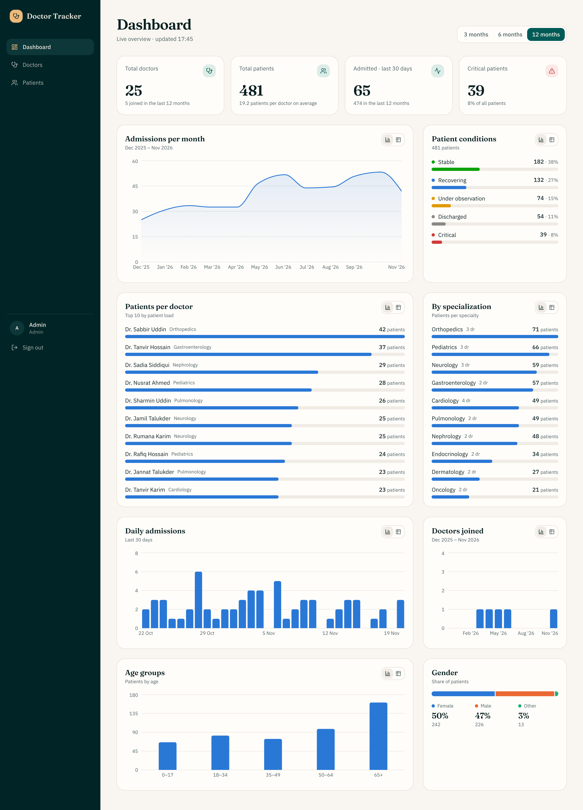 |

| Doctors (search, filters, pagination) | Doctor profile & patients |
|---|---|
| 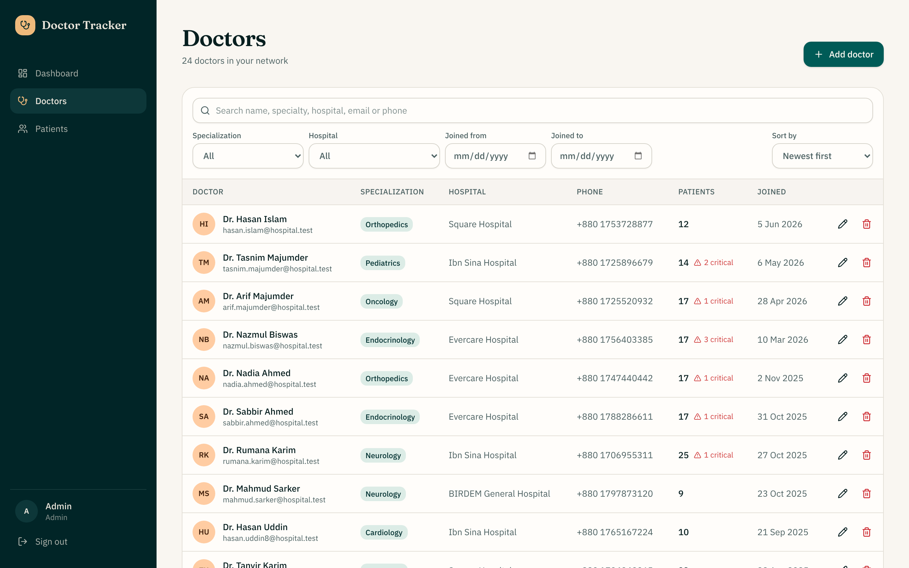 | 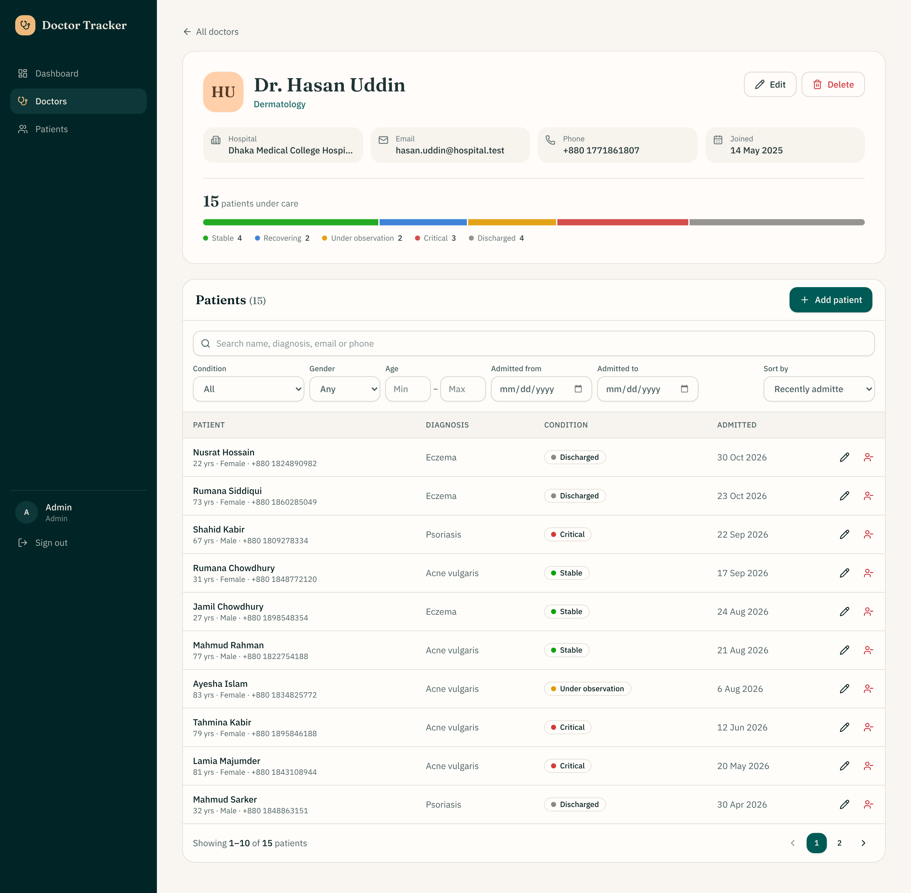 |

| Patients | Patients filtered (critical, admitted since June) |
|---|---|
| 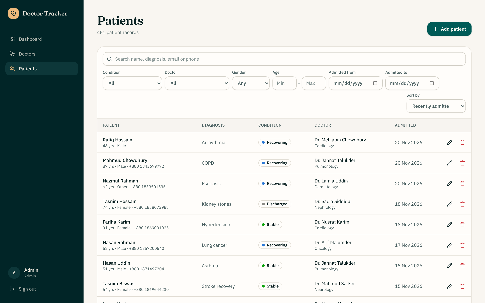 | 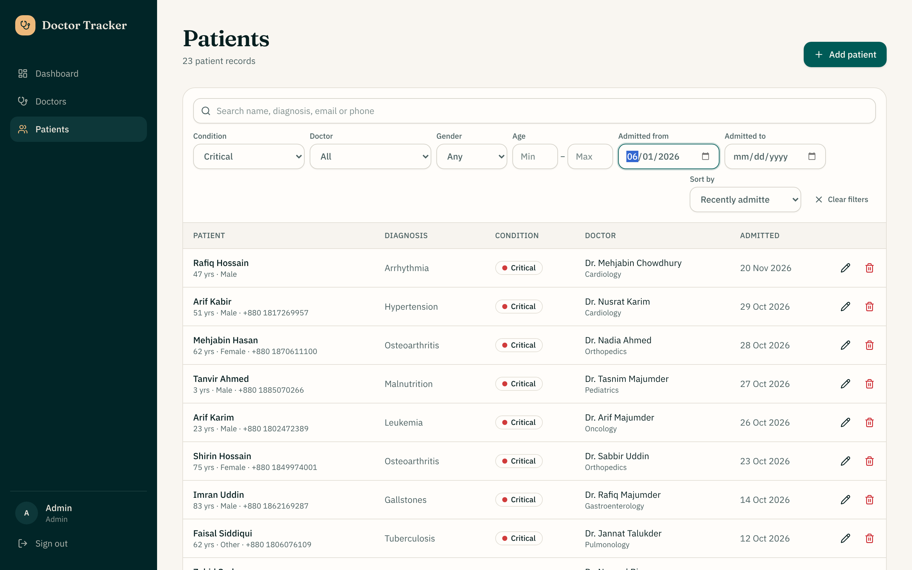 |

| Add doctor — validation | Edit patient | Login |
|---|---|---|
| 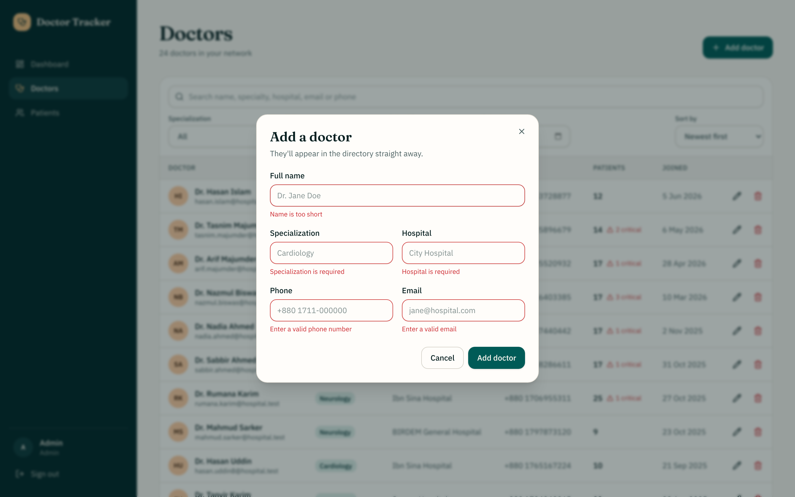 | 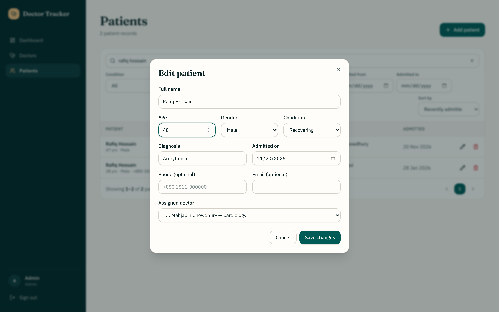 | 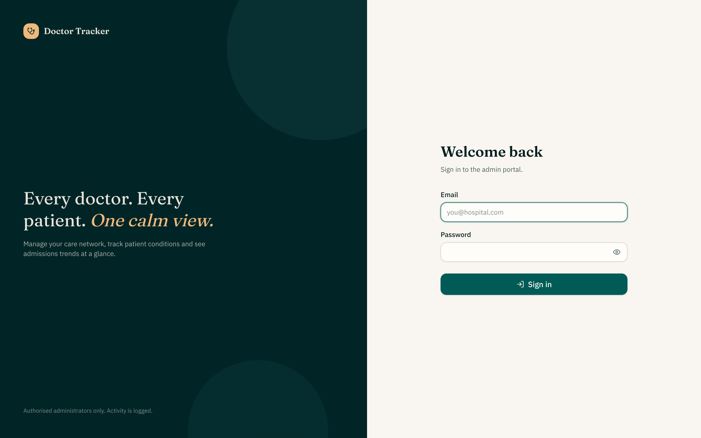 |

### Mobile (390 px)

| Dashboard | Doctors | Filters panel | Doctor profile |
|---|---|---|---|
| 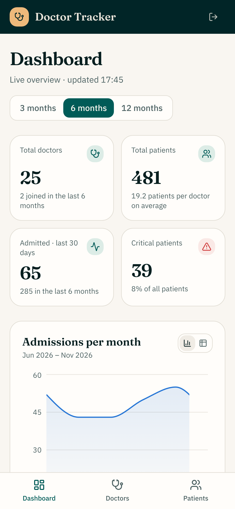 | 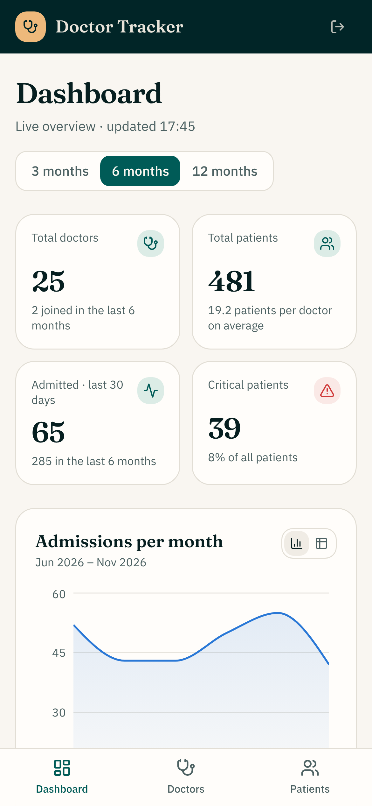 | 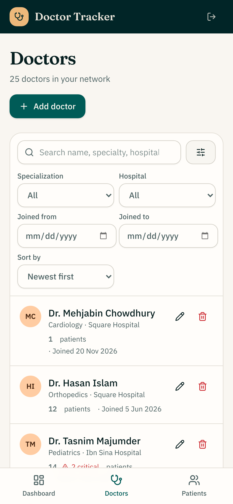 | 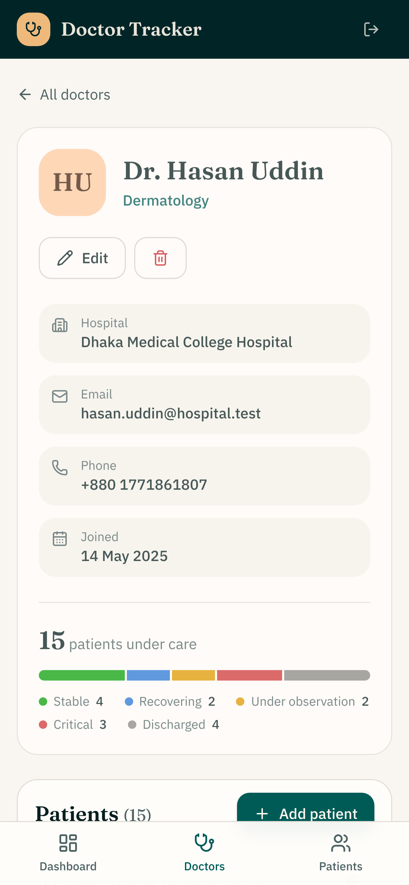 |

| Patients | Add patient | Login | Full dashboard |
|---|---|---|---|
| 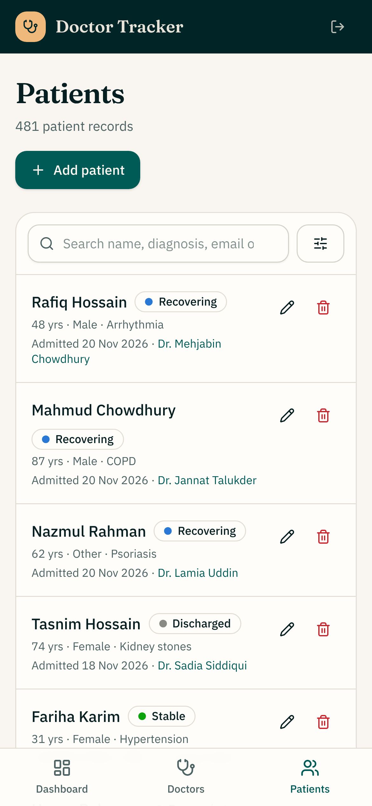 | 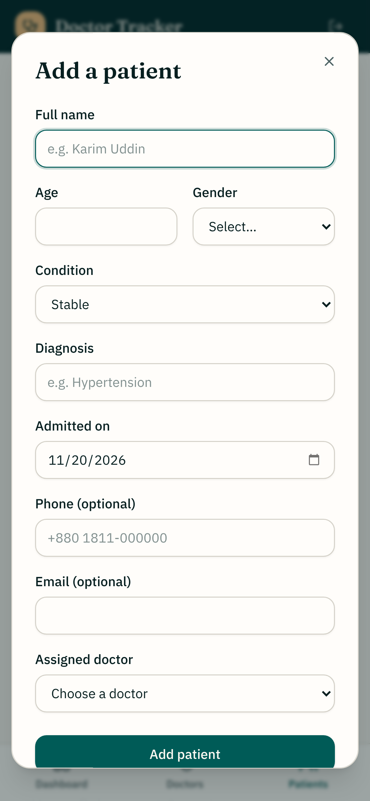 | 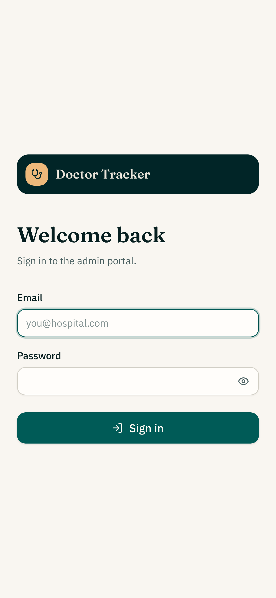 |  |

---

## Requirements checklist

| Spec item | Where |
|---|---|
| Only authenticated users; secure login; protected routes | `proxy.js`, `(portal)/layout.js`, `middleware/auth.js` (`requireAuth` + `requireRole("admin")`) |
| Create doctor (name, specialization, hospital, phone, email) | `DoctorFormDialog` → `POST /api/doctors` |
| List / search / filter (date + specialization + hospital) / paginate doctors | `/doctors` → `GET /api/doctors` |
| View a doctor's patients, add under a doctor, delete from their list | `/doctors/[id]` → `/api/doctors/:id/patients` (GET, POST, DELETE) |
| Patients page: list, edit, delete, paginate, search, filter (date, condition, doctor, gender, age) | `/patients` → `/api/patients` |
| Dashboard: total doctors, total patients, patients per doctor, date-based stats, charts | `/dashboard` → `GET /api/dashboard/stats` |
| Indexing, efficient queries | see *Indexes* plus the query-plan test |
| Avoid unnecessary re-renders, reusable components, clean structure | memo'd rows, debounced search, `components/ui` + `components/common` |
| API validation and error handling | Zod schemas plus a central `errorHandler` |
| Next.js client + standalone Express + MongoDB + REST | `frontend/`, `backend/` |
| README template + `.env.example` | this file, `backend/.env.example`, `frontend/.env.example` |
